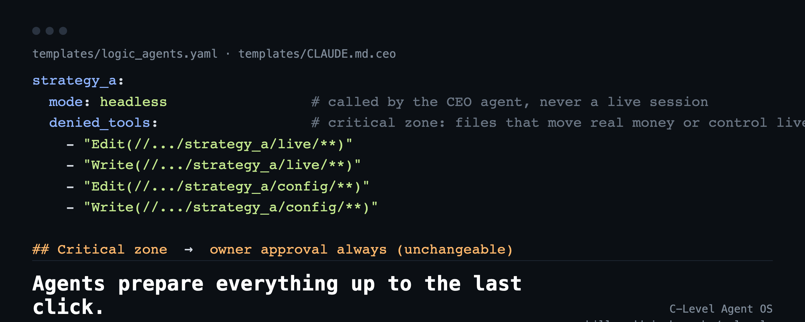

# C-Level Agent OS

### AI 경영진이 운영하는 1인 회사를 위한 운영 구조 하나.

**에이전트가 마지막 클릭 직전까지 전부 준비한다. 당신은 그 클릭만 — 돈이 움직이는 것은 에이전트가 손댈 몫이 아니다.**

[](LICENSE)
[](https://skills.sh/junhwanahn/c-level-agent-os)

[English README](README.md)

CEO 에이전트, C-level 역할 에이전트(템플릿 4개 동봉: CTO·CRO·CFO·CMO — 전략 등 역할은 필요에 따라 추가), headless 로 호출하는
프로젝트 에이전트, 그리고 사람(오너)만 할 수 있는 액션을 모으는 큐 하나로 구성됩니다. Claude Code 용입니다.
1인 시스템 트레이딩 회사가 실제로 만들어 쓰는 구조에서 업종 고유 내용을 모두 걷어냈습니다.

## 빠른 시작

```bash
npx skills add junhwanahn/c-level-agent-os
```

그다음 에이전트에게 *"우리 회사에 C-Level Agent OS 를 설치해 줘"* 라고 요청한다. 스킬이 템플릿을 가져오고,
플레이스홀더 질문을 던지고, 권한을 `proposed` 로 둔 채 첫 점검까지 진행하도록 안내한다.

### 수동 설치

준비물: Claude Code CLI, Python 3.9+, `pip install pyyaml`.

1. **헌장과 역할.** `templates/CLAUDE.md.ceo` 를 CEO 프로젝트 루트에 `CLAUDE.md` 로 복사하고
   `{{...}}` 를 채운다. `templates/agents/*.md` 를 `.claude/agents/` 로 복사한다.
2. **큐와 레지스트리.** `templates/owner_action_queue.yaml`, `templates/logic_agents.yaml` 을 `config/` 에,
   `scripts/logic_agent.py` 를 `scripts/` 에 복사한다. 각 에이전트의 `path` 를 실제 프로젝트 디렉터리로,
   `mode` 를 알맞게 지정한다.
3. **첫 호출 전 점검.**
   ```bash
   python3 scripts/logic_agent.py --status
   python3 scripts/logic_agent.py strategy_a -p "인계 문서를 읽고 현황을 5줄로 보고" --dry-run
   python3 -m pytest tests -q
   ```
   이후 `--dry-run` 을 빼고 실행한다. 허용 목록을 오너가 확정하기 전까지 `permissions_status: proposed` 를 유지한다.

<p align="center"></p>

## 이것은 무엇인가

- **규칙 체계.** 오너는 최종 액션만 한다. 오너의 손이 물리적으로 필요한 일(발송·결제·서명·인증·
  오너만 아는 사실)은 준비를 마친 상태로 큐 하나에 올라가고, 그 밖의 일은 CEO 에이전트가 결정·집행한 뒤
  보고한다. [docs/00](docs/00-philosophy.md) 참조.
- **템플릿**: CEO 헌장(`CLAUDE.md`), CTO/CRO/CFO/CMO 서브에이전트, 자율 운영 정책, 오너 액션 큐,
  프로젝트 에이전트 레지스트리.
- **작은 실행기** (`scripts/logic_agent.py`, Python + PyYAML): 프로젝트 에이전트를 그 디렉터리에서
  headless 로 호출하고, 권한 경계를 유지하며, 세션을 이어 쓰거나 회전하고, 모든 호출을 기록한다.
- **설계 노트**: 2계층 정기보고와 예약 트리거 데몬(데몬 코드는 포함하지 않음).

## 이것이 아닌 것

- **투자·법률·재무 자문이 아니다.** 무엇을 어떻게 거래하라는 내용은 없다.
- **에이전트에게 돈을 맡기는 방법이 아니다.** 결제·이체·자격증명·실자본에 대한 비가역 조치는 사람에게
  남겨 두도록 설계했다. 에이전트에게 자금 보관이나 결제 수단을 주지 말 것.
- 호스팅 제품도, 상주 실행 프레임워크도 아니며(스킬 설치는 지침 파일을 추가할 뿐 서비스를 띄우지 않는다),
  에이전트의 행동을 보증하지 않는다. 권한 규칙은 위험을 줄일 뿐 없애지 않는다. 에이전트가 커밋한 내용은 직접 검토할 것.

## 사례

### 멈춤은 자동이다. 재개는 아니다.

이 구조를 만든 회사는 라이브 전략 VOLCANO 를 사전등록 kill-switch 아래에서 운용했다. 2026-09-23
kill-switch 가 발동해 설계대로 집행됐다. 멈추는 데에는 누구의 결정도 필요 없었다.

그다음 에이전트가 한 일: 기록을 동결하고 공개 문안을 썼다. 하지 않은 일: 자본에 손대거나 무엇이든 재개하는 것.
둘 다 `approval_required: always` 로서 오너의 몫으로 남았다.

공개 기록: [crynomad.ai/track-record.html#volcano](https://crynomad.ai/track-record.html#volcano)

## 구성

```
.agents/skills/c-level-agent-os/  `npx skills add` 용 스킬: 에이전트용 설치·점검 절차
docs/00-philosophy.md             오너는 최종 액션만 한다, 판단 질문 하나
docs/01-ceo-charter.md            헌장 구성, 책임 매트릭스 골격
docs/02-autonomy-policy.md        개선 루프, 블록 예산, 지속성
docs/03-owner-action-queue.md     큐 스키마, 렌더 규칙, 예시
docs/04-logic-agents-headless.md  레지스트리, 권한, 세션 회전, 라이브·headless 동시 금지
docs/05-reporting-daemon.md       2계층 정기보고, 예약 트리거(설계 노트)
templates/                        CLAUDE.md.ceo, agents/, owner_action_queue.yaml, logic_agents.yaml
scripts/logic_agent.py            headless 실행기
tests/test_logic_agent.py         실행기 테스트(stub CLI, 실제 호출 없음)
```

문서 본문, 템플릿, 스킬 파일은 영문입니다.

## 유료: 설치 및 30일 코칭

템플릿은 무료(MIT)입니다. 직접 운영하는 프로젝트에 설치하고 첫 30일 동안 함께 다듬는 서비스가 필요하면
**contact@crynomad.ai** · [crynomad.ai](https://crynomad.ai) 로 연락 주세요.

## 라이선스

MIT. [LICENSE](LICENSE) 참조.
